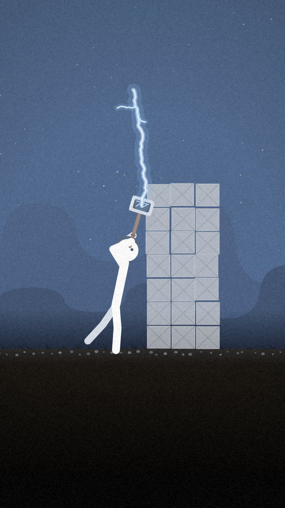

# Kit grátis: Short animado com IA por R$0 (o Short do martelo)

Um Short vertical de 16 segundos (720x1280, 30 fps): um boneco palito com um martelo de raio quebra três muros, o
quarto muro derruba ele, ele levanta, carrega o raio, quebra o último muro e corre até a bandeira enquanto a noite
vira amanhecer. **Tudo desenhado por código** — sem imagem de IA, sem vídeo de IA — e **até o som e a trilha são
criados por código**, sem banco de sons, sem conta e sem chave de API.



Você troca as palavras dos muros, a palavra da bandeira e as legendas, e sai um Short novo em cerca de 1 minuto.
Mostrado no canal [@celticmatheus1](https://www.youtube.com/@celticmatheus1).

## O que precisa (tudo grátis)
- Python 3.10+ e `pip install -r requirements.txt` → depois `python -m playwright install chromium`
- FFmpeg no PATH (Windows: `winget install Gyan.FFmpeg`)
- Para a parte com IA: o ChatGPT grátis (ou qualquer chat) e o [OpenCode](https://opencode.ai) com um modelo
  rodando no seu PC pelo [Ollama](https://ollama.com) (`ollama launch opencode`). Eu testei com o Gemma 4 12B.

## Como usar
1. **Parte 1 no ChatGPT:** cole `prompts/parte1_chatgpt.md`. Ele pergunta os 4 muros, a bandeira, as 3 legendas
   e os sons, e devolve a **FICHA DO SHORT**. Também dá para pedir um tema ("academia", "estudos", "meu negócio").
2. **Parte 2 no OpenCode:** abra o OpenCode **dentro desta pasta**, digite `/new`, cole `prompts/parte2_opencode.md`
   e, logo abaixo, a ficha. O modelo salva a ficha, confere o PC, instala o que faltar e roda o comando.
3. Abra a `folha_de_contato.jpg` e confira os muros, as legendas e a bandeira. O vídeo sai em `meu_short.mp4`.

### Sem IA nenhuma
Cole a ficha em `ficha.txt` e rode:
```
python fazer_short.py
```

## O que vem aqui
- `short.html` — a animação inteira em um canvas (cada quadro é função do tempo: `window.seek(t)`)
- `sons.py` — efeitos e trilha gerados por código (numpy + scipy)
- `render.py` — Chrome sem janela (Playwright) + FFmpeg, com motion blur, som masterizado em −14 LUFS
- `fazer_short.py` — lê a `ficha.txt`, gera `ficha.js`, cria o som, renderiza e faz a folha de contato
- `prompts/` — a parte 1 (ChatGPT) e a parte 2 (OpenCode)
- `exemplo/` — um quadro e a folha de contato de um Short feito pelo Gemma 4 com este kit

## Dicas
- Palavras dos muros curtas (até ~15 letras) e legendas com até ~22 letras por linha.
- O modelo grátis às vezes diz que terminou sem ter terminado: abra a folha de contato você mesmo.

## Licença
MIT (veja `LICENSE`). A fonte Inter é carregada do Google Fonts (SIL Open Font License 1.1).
